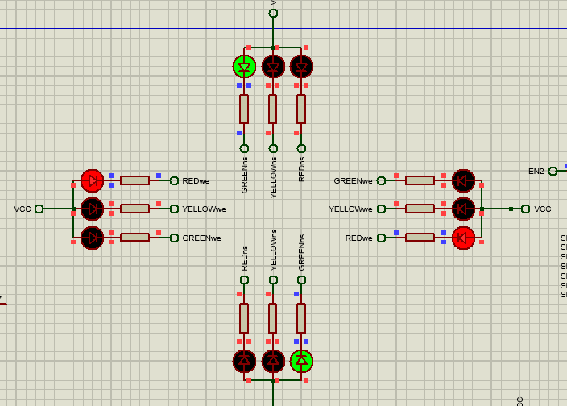

# Biên bản đối chiếu

| Phép thử | Thao tác / kết quả | Giới hạn |
|---|---|---|
| CubeIDE 1.7.0 | Debug build: 0 lỗi, 0 cảnh báo. ARM size: text 18.844 B, data 128 B, bss 2.144 B. | Không kết nối ST-LINK |
| Proteus 8.10, mạch assignment nguyên bản | Run: “No power supply specified for net 3.3V in Power Rail Configuration.” | Netlist chưa biên dịch |
| Bản sao assignment | Bổ sung nguồn 3,3 V và binding net. Run tiếp: “No model specified for U1.”, “No model specified for U12.” | U1 = STM32F103R8T6, U12 = SEN-18364. Chỉ có ký hiệu thì không chạy được firmware và cảm biến. Đổi đường dẫn HEX không sửa được lỗi model. |
| Proteus 8.10, mạch C6 | Build HEX từ cùng mã FSM. VSM hiển thị ANIMATING; ở khoảng 0,35 s hướng dọc xanh/ngang đỏ; khoảng 6,88 s trên đồng hồ VSM quan sát hướng ngang xanh/dọc đỏ | Quan sát màu thực trên mạch C6; đồng hồ quan sát không phải phép đo thời lượng từng pha và không thay thế đo board. |
| Host GCC | Scheduler chèn đầu/giữa/cuối, trùng hạn, xóa, one-shot, đầy hàng đợi, dispatch muộn; Auto qua bốn pha, đổi mode khi vàng, chống dội, nhấn lâu, từ chối/áp dụng timing; khung DHT20 25,0°C / 50,0%, lỗi CRC, mất I2C | Dùng GPIO và I2C giả; chỉ xác nhận logic, không xác nhận pin hoặc LCD vật lý |
| Board XNUCLEO-F103RB | Chưa chạy theo phân công của nhóm | Chưa có kết quả đo bảng mã, địa chỉ LCD, nhiệt/ẩm thật, chạy bền, hay tỷ lệ đóng góp |

**Chạy lại host test**: từ gốc repo dùng `python tests/run.py`. Cần Python 3, GCC C11 trong PATH. Windows/MinGW: thêm thư mục `bin` của MinGW vào PATH (để tìm các DLL); có thể đặt `CC` thành đường dẫn đến `gcc.exe`. Mỗi phép thử dùng `assert`; exit code khác 0 là thất bại.

**Cách diễn giải thời gian:** bộ test kiểm tra ngưỡng chuyển pha theo tick scheduler; chỉ board đúng clock 8 MHz mới dùng kết quả ấy để suy ra thời gian thực. Muốn đo độ dài pha trên mạch, ghi cạnh của cả hai ngõ ra theo cùng đồng hồ rồi lấy hiệu giữa các cạnh liên tiếp. Phép thử ảnh chưa đo yêu cầu này.

Đối chiếu giao thức môi trường với [datasheet DHT20 của ASAIR](https://asairsensors.com/wp-content/uploads/2021/09/Data-Sheet-DHT20-Humidity-and-Temperature-Module-ASAIR-V1.0.03.pdf). Host test có cả trường hợp sensor báo chưa sẵn sàng sau reset: đọc và khôi phục ba thanh ghi, kiểm tra lại trạng thái rồi mới đo.

**Phiếu chạy board** (tạo bản ghi riêng, kèm commit, người đo và ngày):
1. Mỗi tổ hợp 00, 01, 10, 11: ghi màu **riêng cho từng đường**; đối chiếu thứ tự A/B.
2. Với từng nút D7…D10 và USER, ghi mức thả/nhấn. Chụp Live Expressions khi I2C scan xong; ghi địa chỉ 7 bit của từng thiết bị và pin mapping LCD nếu không khớp PCF8574 mặc định.
3. Ghi thời điểm qua từng pha trong hai chu kỳ, vào Manual khi vàng, thử Tuning sai (8/5/2) rồi hợp lệ (8/6/2). Rút cảm biến trong một lượt riêng, xác nhận màn hình báo mất số liệu và chu kỳ đèn tiếp tục.
4. Nhóm chọn khoảng chạy bền, ghi giờ bắt đầu/kết thúc, số lần lỗi và hiện tượng. Không điền “đạt” nếu chưa thực hiện.
