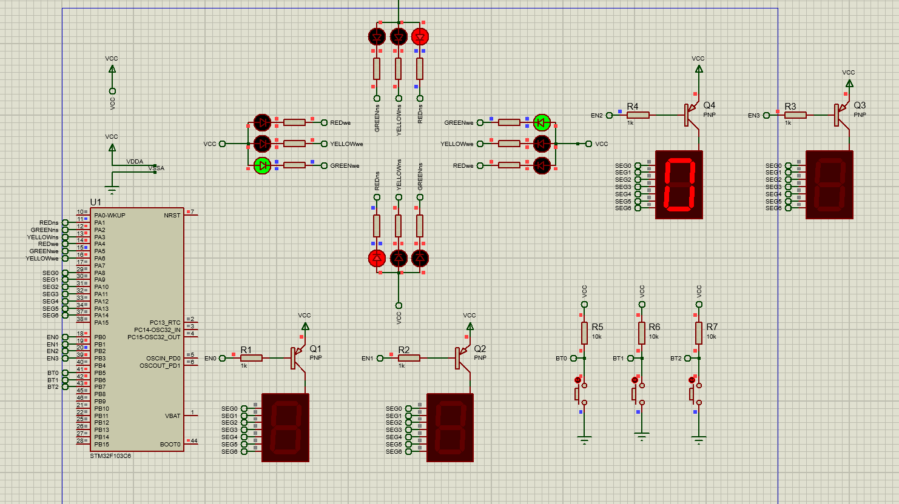

# Test results

## Firmware

The RB debug build on 22 November completed in STM32CubeIDE 1.7.0 with zero errors and warnings. The image used 18,844 bytes of text, 128 bytes of initialized data and 2,144 bytes of BSS.

The host suite passed on 26 November at firmware commit `4df019e`. Run it from the repository root with `python tests/run.py`.

| Test | Result |
|---|---|
| Scheduler | One-shot and periodic tasks ran in order through cancellation, equal deadlines, a full queue and delayed dispatch. An overdue task ran before a new task with the maximum delay, including across clock wrap. The queue also matched a reference scheduler over 20,000 randomized operations. |
| Lights and buttons | All four automatic phases ran in order. Pressing MODE during amber entered Manual with both roads red. MODE took priority over a simultaneous NEXT press. Debounce, long presses and cancellation of the previous timer passed. |
| Timing menu | All three fields stopped at 1 and 99 s. The controller rejected 8/5/2 and accepted 8/6/2 (red/green/amber). |
| DHT20 and LCD | A simulated frame produced 25.0 °C and 50.0% humidity on the decoded LCD. Tests covered calibration recovery, bad CRC, an absent device, a busy sensor, and the timing-menu error message. |
| Continuous operation | Over 360,000 simulated ticks (one hour), at least one road was red on every phase update. Physical run time and phase lengths still need measurement. |

TIM2 generates the 10 ms tick from an 8 MHz clock with prescaler 7999 and auto-reload 9. The interrupt checks only the first task, so its work stays constant as the queue grows. The three mode state machines run as separate tasks. They make no HAL calls. I2C transfers have bounded timeouts.

## Proteus

On 22 November the C6 circuit ran in Proteus 8.10. Both directions took a turn at green while the other stayed red. Commit `4df019e` updated the demo HEX. The C6 circuit has LEDs and buttons, with no DHT20 or LCD.

| North-south green, east-west red | East-west green, north-south red |
|---|---|
|  |  |

The original assignment schematic stopped at an undefined 3.3 V rail. The copy in this repository fixes the rail. Proteus then reported `No model specified` for U1 (STM32F103R8T6) and U12 (SEN-18364).

## Board checks still open

Record the date, firmware commit and tester with the measurements.

- Flash twice over SWD. Check the PA5 and PC9 blink intervals, the four A:B codes on each light module, and the pressed and released levels of all buttons.
- Scan I2C, record both 7-bit addresses and check the LCD backpack wiring. Read temperature and humidity, then unplug the DHT20 and check that the lights keep cycling.
- Measure two complete traffic cycles. Switch to Manual during amber and try both timing examples above.
- Record start and end times for the endurance run, along with any faults. The assignment leaves the duration unspecified.

Sensor reference: [ASAIR DHT20 datasheet](https://asairsensors.com/wp-content/uploads/2021/09/Data-Sheet-DHT20-Humidity-and-Temperature-Module-ASAIR-V1.0.03.pdf).
